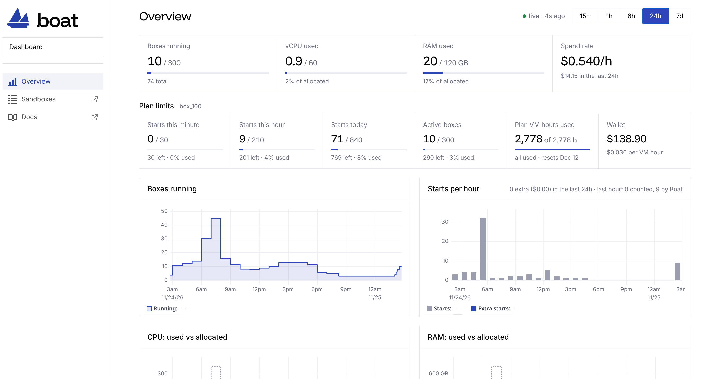

# boat-dashboard



A live dashboard of a [Boat](https://boat.dev) account's sandboxes. It shows over up to 7 days:

- boxes running
- vCPU and RAM used against allocated
- spend per hour
- the plan's limits: starts per minute, hour and day, active boxes, included VM hours
- the wallet
- starts and extra starts per hour
- the boxes by cost and by uptime

One Bun server polls Boat for every viewer and streams updates over SSE. The page is React with uPlot charts.

## Run

```sh
bun install
echo "BOAT_API_KEY=..." > .env
bun run start          # http://localhost:3010, or set PORT
```

- `bun run dev` runs it with hot reload.
- `bun test` runs the tests.
- `bun run typecheck` checks the types.

History, the per-box hourly usage ledger and start counts are saved under `~/.local/state/boat-dashboard`, so they survive restarts. Boat keeps no history of starts, so starts are counted only while the server runs.
